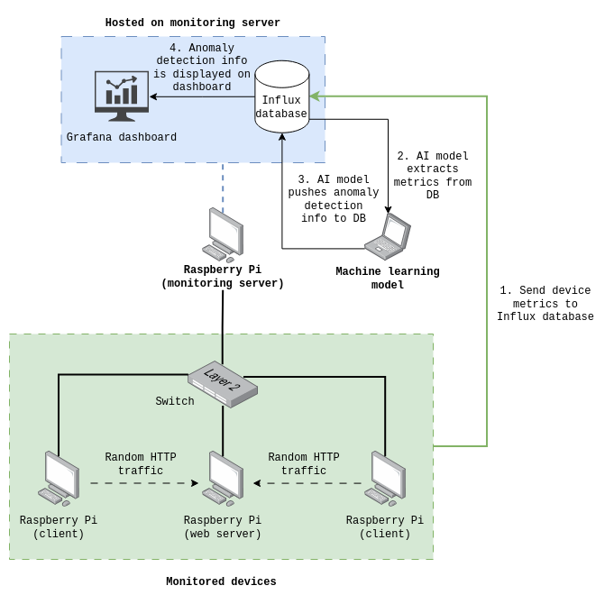

# Overview
The objective of this project was to develop an AI-based predictive
maintenance system to predict faults in network devices. A small
isolated network, consisting of four Raspberry Pis and one switch, was
built for the purpose of collecting training data for the machine
learning models and testing the capability of each trained
model. Metrics were collected as time series data from three of the
Raspberry Pis via Python scripts, with the fourth hosting a central
Influx database for storing metrics samples, and a monitoring
dashboard (Grafana) to display insights produced by the AI model, in
addition to other information about the network. Metrics were also
collected from the switch over SNMP, using the Influx SNMP plugin.

While we were able to develop an anomaly detection model to identify
anomalies in device metrics over time, the system is not yet capable
of predicting potential faults in the monitored devices. Therefore,
future research efforts should be primarily focused on using the
outputs of the anomaly detection model as a basis for device fault
prediction. The machine learning models and collection scripts may
also need to be refined in future.



# Description of repository contents
This repository contains all of the artifacts required for continued
development and testing of the experimental predictive maintenance
system:
- Source code for the machine learning models (one-class SVM and LSTM)
  in the `models` directory, in Jupyter notebook format (`ipynb`). The
  results of the training and testing of these models are also
  included in the notebooks, in graphical and tabular format.
- Device collection scripts, (in the `scripts/collection` directory)
  which collect samples from each of the three monitored Raspberry Pi
  devices every ten seconds. It is recommended to use version 2.1,
  which supports the most metrics and is the most reliable version of
  the script; however, older versions of the script may be used for
  compatibility with older devices.
- The anomaly pipeline script (`scripts/anomaly2influx.py`), which
  is used to push predictions made by the anomaly detection models to the
  Influx database in real time.
- The YAML configuration file for the Influx SNMP plugin (also in the
  `scripts/collection` directory), used to query various metrics from
  the switch's MIB over SNMPv2 every ten seconds.
- The web traffic simulation script (`scripts/request.py`), which
  sends an HTTP request to one of the Raspberry Pis (the 'web server'
  Pi, running an Apache2 server) at random every 0-30 seconds.
  
The CSV files containing samples collected from the three Raspberry
Pis and switch can be accessed by contacting the project sponsor, as
they are too large to be stored in this repository.

# Dependencies
## Software
- Python 3
- InfluxDB
- Grafana
- Apache2
## Libraries for the Python scripts
- `influxdb-client`
- `numpy`
- `pandas`
- `psutil`
- `requests`
- `zoneinfo`
## Libraries for the machine learning models
- `joblib`
- `matplotlib`
- `numpy`
- `pandas`
- `scikit-learn` (`sklearn`)
- `tensorflow`

# Configuration steps
## Setting up the network environment
1. Connect all devices (monitored devices and monitoring server) to
   the switch, assign a static IP address to each device, and test
   connectivity. Configure interfaces on the switch as necessary - all
   devices should be on the same VLAN. Set up SSH on each device to
   simplify configuration and maintenance.
2. Install InfluxDB and Grafana on the device that will act as the
   monitoring server; configure each using the configuration files
   from this repository. Enable the `systemd` services if
   necessary. Create a separate Influx bucket for each monitored
   device.
3. On the 'webserver' device, install Apache and enable the `systemd`
   service (`sudo systemctl enable --now apache2`) to start the server
   process. Confirm that the site is accessible by accessing it from
   another device.
4. On each 'client' device (which send random HTTP requests to the
   'webserver' device to simulate network activity), upload the
   `request.py` Python script (found in the `scripts`
   directory). Modify the IP address in the script so that requests
   are sent to the correct device. Install the `requests` Python
   library and start the script in the background:
   
   ```
   nohup python3 request.py &
   ```

## Setting up metrics collection
### End devices (Raspberry Pis)
5. Upload the metrics collection Python script to each monitored
   device (we did this over SFTP). Alter each script so that the
   metrics are sent to the correct bucket on the monitoring
   server. Generate a unique Influx token for each monitored device
   and update the scripts accordingly.
6. Install the remaining Python dependencies on each monitored device
   using `pip`. Start the script in the background:
   
   ```
   nohup python3 CollectorV2.1.py &
   ```
7. Using the Influx web interface, verify that metrics are being
   pushed to the correct bucket on the database.
### Switch 
8. Connect to the switch over a console connection and enter global
   configuration mode. Enable SNMPv2 using the following command:
   
   ```
   snmp-server community password ro
   ```
9. On the Influx web interface, install the TOML configuration file
   for the SNMP plugin. Generate a new Influx token for the
   switch. Install `telegraf` on the monitoring server.
10. On the monitoring server, execute the following command:

	```
	TODO...
	```
11. Verify that switch metrics are being collected by Influx.

## Setting up the machine learning models and dashboard
### Dependencies
The following CSV files were used to train and test the machine
learning models:
- Client1(all).csv
- Client2(all).csv
- Client3(all).csv
- Switch(all).csv
- Client1(original).csv
- Client2(original).csv
- Client3(original).csv
- Switch(original).csv
These files can be provided by the project sponsor upon request.

Python 3.12 or higher is recommended for running the machine learning
models, as well as an up to date VS Code environment.

### Running models
The models are stored in three Jupyter notebook (`.ipynb`) files: 

- `LSTM(all metrics).ipynb` - runs LSTM model using all csv metrics
- `LSTM(original metrics).ipynb` - runs LSTM model using core 7 metrics
- `OCSVM(all + original metrics).ipynb` - runs OCSVM for both
  depending on which the user would like, by changing a variable from
  "original" to "all" or vice versa.

To run each model the user can run each cell individually, or run all.

### Analysing findings
To view the results of all models without rerunning the code, each
model's results are stored within folders:
- LSTM (all metrics) - found in folder `Expanded_LSTM_Results`
- LSTM (original metrics) - found in folder `LSTM_Results`
- OCSVM (all + original metrics) - found in folders
  `OCSVM_All_Metrics_Results` (for all metrics) and
  `OCSVM_Original_Results` (for original metrics)

### Connecting models to Influx
1. Create a new bucket on Influx to store the anomaly predictions (in
   the script, a bucket named `MLCL1` is used by default.
2. Generate a new Influx token and add it to `anomaly2influx.py` (or
   as an environment variable on the machine on which the model is
   hosted).
3. Run the script (`python3 anomaly2influx.py`) to begin pushing
   predictions to Influx.

# Specifications of Monitored Devices
Health and performance metrics were monitored on the following devices
during the development of the project:
- Cisco Catalyst CX 3560-CX switch
- Raspberry Pi 4 Model B (4GB) (Client 1)
- Raspberry Pi 4 Model B (Client 2)
- Raspberry Pi 3B+ (Webserver)

In addition, the monitoring server (on which the Influx database
and Grafana dashboard were hosted) was a Raspberry Pi 3B+.

# Metrics observed on the monitored devices
## Raspberry Pis
* Uptime (seconds)
* CPU utilisation (%)
* CPU temperature (C°)
* CPU voltage
* CPU clock speed (MHz)
* Disk usage
* Packet loss rate (%)
* Packet error rate (%)
* Latency (ms)
* Throughput (bps)
* Reachability
* CPU throttled?
* CPU speed capped?
* Low voltage?
* Estimated power draw (Watts)

## Switch
TODO

##AI Usage
###OpenAI's GPT-6 was guided to produce the machine learning models for the sake of clarity and structure. it was alos used to format the dataset files into more readable forms.
